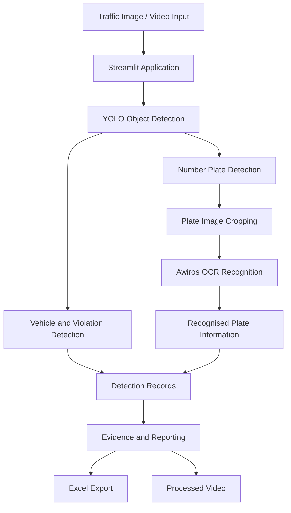

# YOLOCOP – AI-Powered Traffic Violation Detection System

<p align="center">
  <strong>Intelligent Traffic Monitoring • Computer Vision • Deep Learning</strong>
</p>

<p align="center">
  An AI-powered traffic monitoring system designed to detect road-safety violations using YOLO object detection, OpenCV, Python and Streamlit.
</p>

<p align="center">
  
  
  
  
  
  
</p>

---

## Overview

**YOLOCOP** is an AI-based Traffic Violation Detection System developed to support intelligent traffic surveillance and road-safety monitoring.

The system uses a custom-trained YOLO object detection model to analyse traffic images and video footage, identify vehicles and detect specific traffic violations. It combines computer vision, deep learning and an interactive Streamlit interface to present detection results and generate reports.

The project also incorporates an Automatic Number Plate Recognition (ANPR) pipeline using a number-plate detection and OCR recognition workflow.

YOLOCOP aims to demonstrate how Artificial Intelligence and Computer Vision can assist traffic monitoring operations by reducing manual video inspection and organising detected violations into structured evidence and reports.

## Key Features

### 1. AI-Based Traffic Violation Detection
- Helmet compliance detection.
- Without-helmet detection.
- Triple-riding detection.
- Mobile-phone usage detection.
- Motorcycle and vehicle detection.
- Number-plate region detection.

### 2. Automatic Number Plate Recognition (ANPR)
- Detection of number-plate regions using YOLO.
- Cropping of detected number-plate regions.
- Integration with the Awiros OCR recognition model.
- OCR text and confidence information when successfully recognised.
- Vehicle and detection record association.

### 3. Video Analysis
- Upload traffic video footage.
- Process video frames using the trained YOLO model.
- Display annotated detection results.
- Record violation categories and confidence values.
- Generate processed video evidence.

### 4. Interactive Traffic Monitoring Dashboard
- Streamlit-based application interface.
- Image and video analysis workflow.
- Detection summaries.
- Violation records and evidence presentation.
- Structured reporting and Excel export.

### 5. Reporting and Evidence Management
- Vehicle-wise violation records.
- Detection-wise information.
- Number-plate recognition records.
- Detection confidence and OCR confidence fields.
- Excel-based reporting for further analysis.

*Detection and OCR results are AI-generated and may require manual verification.*

## Traffic Violation Detection Classes

The custom YOLO model is trained with six object classes:

| Class ID | Detection Class | Description |
|---|---|---|
| 0 | Bike | Motorcycle detection |
| 1 | Number Plate | Vehicle number-plate region |
| 2 | Triple Riding | Three or more persons riding a motorcycle |
| 3 | Using Mobile | Mobile-phone usage while riding |
| 4 | With Helmet | Rider wearing a helmet |
| 5 | Without Helmet | Rider without a helmet |

## System Architecture



## Technology Stack

| Technology | Purpose |
|---|---|
| Python | Core programming language |
| Ultralytics YOLO | Object detection |
| PyTorch | Deep learning framework |
| OpenCV | Image and video processing |
| Streamlit | Interactive web application |
| Awiros OCR | Number-plate text recognition |
| PaddleOCR components | OCR runtime integration |
| Pandas | Data processing and reporting |
| OpenPyXL | Excel report generation |

## Custom YOLO Model

YOLOCOP uses a custom-trained YOLO object detection model.

**Model location:**

```text
runs/
└── detect/
    └── outputs/
        └── traffic_violation_v1/
            └── weights/
                └── best.pt
```

The trained model is used for identifying motorcycles, number plates and traffic-violation categories.

The model was evaluated using validation data. Detection performance is not guaranteed to be perfect and may vary depending on camera quality, lighting, object size, video resolution and viewing angle.

## Project Directory Structure

```text
YOLOCOP/
│
├── app.py
├── requirements.txt
├── README.md
├── .gitignore
│
├── lpr_engine/
│   └── awiros_anpr/
│       ├── test.py
│       └── PaddleOCR/
│
├── runs/
│   └── detect/
│       └── outputs/
│           └── traffic_violation_v1/
│               └── weights/
│                   └── best.pt
│
└── tools/
```

*The directory structure above illustrates the principal application components. Optional assets and model files may be stored separately.*

## Installation and Setup

### Prerequisites

- Windows, Linux or macOS.
- Python environment compatible with the project dependencies.
- Git.
- FFmpeg for video processing.
- Sufficient CPU or GPU resources for model inference.

### 1. Clone the Repository

```bash
git clone https://github.com/salmanfawaz07/YOLOCOP.git
```

```bash
cd YOLOCOP
```

### 2. Create a Virtual Environment

```bash
python -m venv .venv
```

Windows PowerShell:

```powershell
.\.venv\Scripts\Activate.ps1
```

### 3. Install Dependencies

```bash
python -m pip install --upgrade pip
pip install -r requirements.txt
```

### 4. Configure Model Assets

Place the trained YOLO model at the path expected by the application:

```text
runs/detect/outputs/traffic_violation_v1/weights/best.pt
```

The Awiros OCR recognition model is a separate asset and must be obtained and configured independently. It is not included in this repository.

### 5. Install FFmpeg

Install FFmpeg and ensure that its executable is available through the system PATH.

Verify:

```bash
ffmpeg -version
```

### 6. Launch YOLOCOP

```bash
streamlit run app.py
```

Open the local application in your browser:

```text
http://localhost:8501
```

*Note: The repository's model assets and OCR runtime must be configured before all application features can operate. Check the application configuration and dependency requirements before deployment.*

## Model and Asset Availability

The trained YOLO model and OCR recognition model are separate assets.

- YOLO weights: `best.pt`
- Awiros OCR weights: `model.safetensors`
- OCR character dictionary: `en_dict.txt`

Large model files may be distributed separately from the Git repository. Their paths must match the application configuration.

## Current Development Status

YOLOCOP is an actively developing project.

Current development areas include:

- Improving object detection accuracy.
- Refining number-plate recognition.
- Improving vehicle-to-violation record association.
- Reliable video processing and encoding.
- Structured Excel reporting.
- Application deployment and optimisation.

## Future Enhancements

- Real-time traffic camera integration.
- Improved vehicle tracking across video frames.
- Multi-camera traffic monitoring.
- Advanced ANPR accuracy improvements.
- Traffic violation analytics and visual dashboards.
- Centralised monitoring for multiple locations.
- Cloud-based deployment and reporting.
- Role-based access and secure evidence management.

## Applications and Use Cases

Potential applications include:

- Intelligent traffic surveillance.
- Road-safety monitoring.
- Helmet compliance monitoring.
- Motorcycle triple-riding identification.
- Mobile-phone usage monitoring.
- Automated review of traffic video footage.
- AI-assisted traffic violation reporting.

## Important Disclaimer

YOLOCOP is an AI-assisted traffic monitoring and research project. Its outputs are automated predictions and should not be treated as conclusive evidence of a violation without appropriate human verification and applicable legal procedures.

The project is not affiliated with or endorsed by any government traffic enforcement authority.

## Contributing

Suggestions, bug reports and contributions are welcome.

Before submitting changes:
1. Review the existing application structure.
2. Avoid committing large datasets, private files or credentials.
3. Test modifications before submitting a pull request.
4. Document new dependencies and configuration requirements.

## Author

**YOLOCOP – AI Traffic Violation Detection System**

Developed by **Salman Fawaz**

GitHub: [@salmanfawaz07](https://github.com/salmanfawaz07)

Repository: [YOLOCOP](https://github.com/salmanfawaz07/YOLOCOP)

---

<p align="center">
  <strong>YOLOCOP</strong><br>
  AI-Powered Traffic Monitoring for Safer Roads
</p>
